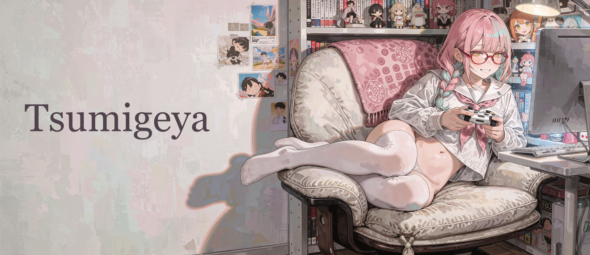
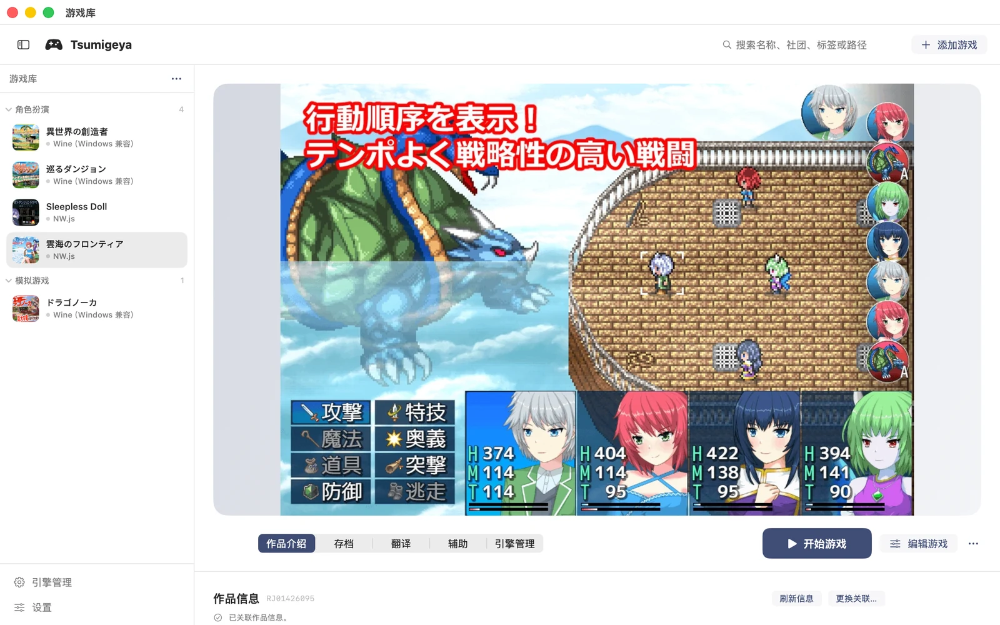
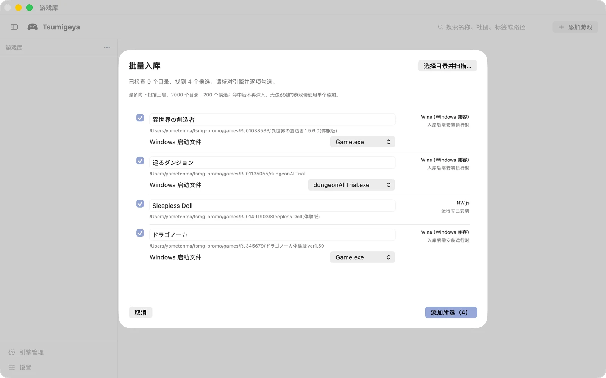
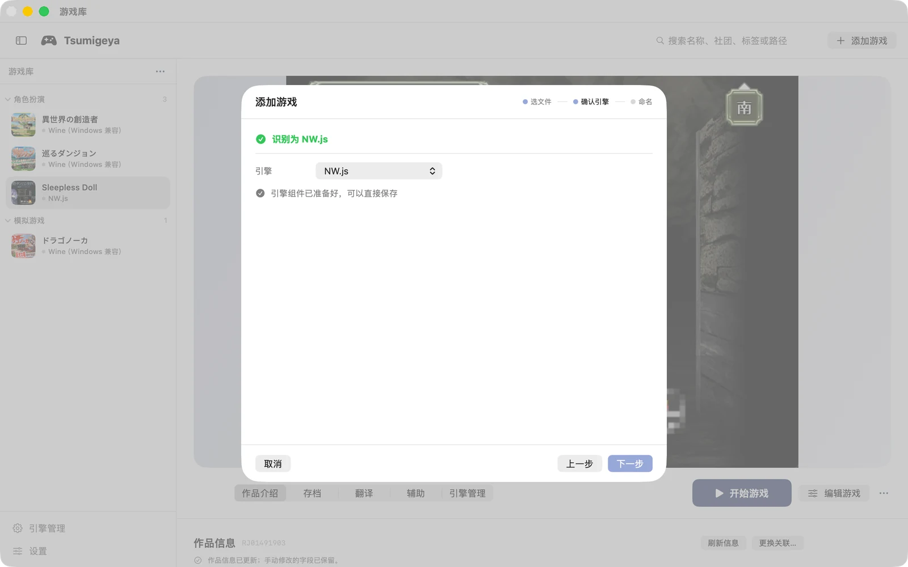
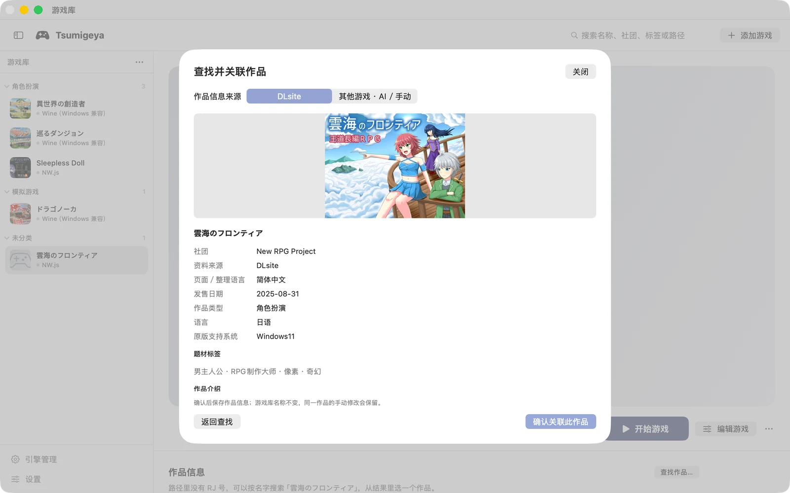
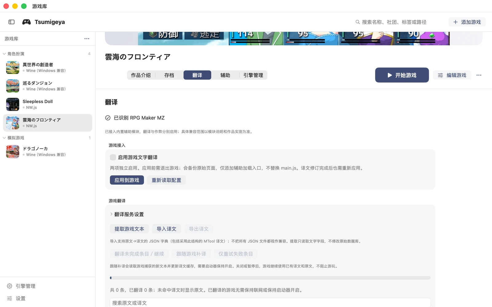

<p align="center">
  
</p>

<p align="center">
  <a href="README.md"></a>
  <a href="README.zh-CN.md"></a>
  <a href="README.ja.md"></a>
</p>

<p align="center">
  <a href="https://github.com/Yometenma/Tsumigeya/releases/latest"></a>
  
  
  
  <a href="LICENSE"></a>
  <a href="https://github.com/Yometenma/Tsumigeya/stargazers"></a>
  <br>
  <a href="https://discord.gg/kqut5fAnyk"></a>
  <a href="#community"></a>
  <a href="https://yometenma.github.io/Tsumigeya/"></a>
</p>

<p align="center">
  <b><a href="https://yometenma.github.io/Tsumigeya/">公式サイト</a></b> ✦
  <b><a href="https://github.com/Yometenma/Tsumigeya/releases/latest">最新版をダウンロード</a></b> ✦
  <a href="#compatibility">ゲームの互換性</a> ✦
  <a href="docs/ja/faq.md">よくある質問</a> ✦
  <a href="更新日志.md">更新履歴</a> ✦
  <a href="CONTRIBUTING.md">開発に参加</a>
</p>

<p align="center"></p>


**Tsumigeya** は、DLsite の同人ゲームのための**macOS ネイティブランチャー**です。

すでにダウンロードして解凍したゲームをライブラリに追加すると、エンジンを判別して対応するランタイムを導入し、同じ場所から起動・管理できるようになります。作品情報、分類、セーブデータのバックアップもここにまとまるので、フォルダを行き来する必要はありません。

> [!NOTE]
> **汎用の Windows エミュレーターではなく、ゲームの購入やダウンロードも行いません。** 起動できるかどうかはエンジン、スクリプト、プラグイン、ランタイムの互換性に依存します。判別に成功しても、すべての作品が動くという意味ではありません。

<br clear="right">

<p align="center">
  
</p>
<p align="center"><sub>実際の画面（ライトテーマ）。デモ画面：『雲海のフロンティア』体験版 © New RPG Project</sub></p>

<a id="highlights"></a>

## ✦ 最近の更新

**v3.1.8**

- NScripter と RPG Maker 2000／2003 の作品で「翻訳」タブが「補助設定を読み込み中……」のまま止まる問題を修正しました。これらのエンジンは注入できるスクリプト層がなく、そもそも注入セッションが存在しないのですが、UI 側がそれを「読み込み中」と誤解していました。現在は両タブともオフライン書き換え画面を直接開きます。
- オフラインの書き戻しに保護を追加：ゲームの実行中は拒否（実行中のエンジンはメモリ上のスクリプトを書き戻すため）、ゲーム記録が失効した場合やパスが変わった場合も拒否し、ID が再利用された別の作品へ書き込むことを防ぎます。従来はボタンが無効なだけでした。
- バックアップ名を `.tsumigeya-bak` に統一。旧 `*.bak` も引き続き認識するため、復元やクリーンアップが「見覚えのないファイル」で止まることはありません。
- Ruby Marshal の解析、NScripter のオフライン書き換え、RPG Maker 2000／2003 のデータベース、オフラインセーブ、書き戻し保護の英語・日本語文言を補完しました。

[v3.1.8 をダウンロードして更新内容を見る](https://github.com/Yometenma/Tsumigeya/releases/tag/v3.1.8) · [作品情報の取得](docs/ja/game-info.md) · [更新履歴（中国語）](更新日志.md)

<a id="features"></a>

## ✦ できること

<table>
  <tr>
    <td width="50%" valign="top">
      <br>
      <b>📚 ゲームを自分だけの本棚に</b><br>
      <sub>サイドバーからの一覧と詳細表示、検索、カスタム分類に対応し、1 つの作品を複数の分類に入れられます。解凍済みのゲームが入ったフォルダを指定し、内容を確認してからまとめて追加できます。</sub>
    </td>
    <td width="50%" valign="top">
      <br>
      <b>⚙️ 実行環境の手間を減らす</b><br>
      <sub>ファイル構成からエンジンを判別し、ランタイムの導入と管理を 1 か所にまとめます。起動状態とエンジン引数も確認できます。ランチャーを終了してもゲームは動き続けます。</sub>
    </td>
  </tr>
  <tr>
    <td width="50%" valign="top">
      <br>
      <b>🔍 作品情報を補完する</b><br>
      <sub>作品名、RJ 番号、作品リンクから DLsite を検索し、成人向けと全年齢の作品をまとめて扱えます。カバー、全文の紹介、発売日、シリーズ、タグ、言語、制作・声優、プレビュー画像を作品ページの情報に沿って表示します。関連付ける前にプレビューで確認でき、手動で直した項目は更新しても保持されます。</sub>
    </td>
    <td width="50%" valign="top">
      <br>
      <b>🈳 翻訳とアシスト</b><br>
      <sub>RPG Maker MV/MZ、XP/VX/VX Ace、Ren’Py、Tyrano は翻訳管理と任意の AI 接続を共通で使い、表示テキストの差し替え、数値の編集、ロック、数値の絞り込みはエンジンごとの方式で接続します。対応機能と検証範囲はエンジンによって異なり、起動できることはアシストに対応していることを意味しません。使用前にセーブデータをバックアップしてください。詳しくは<a href="docs/ja/translation-and-cheats.md">使い方</a>をご覧ください。</sub>
    </td>
  </tr>
</table>

- **一括補完**：現在の絞り込み範囲に対して作品情報を補完し、保存済み・確認待ち・失敗の項目をそれぞれ処理します。
- **ローカルの画像・情報キャッシュ**：ダウンロード済みのカバーとプレビュー画像はまずローカルから読み込み、テキスト情報はメモリに保持するため、画面の更新のたびにファイルを読む必要がありません。
- **ゲームの進行をバックアップ**：セーブ位置の特定に対応したエンジンでは、セーブフォルダを ZIP として書き出し、そこから復元できます。取り込み前にファイルを検証し、既存ファイルをバックアップします。ゲームの実行中は書き出しと取り込みを行えません。

<a id="install"></a>

## ✦ ダウンロードとインストール

> [!IMPORTANT]
> **macOS 26** 以降と **Apple Silicon** が必要です。Intel 向けのパッケージは提供していません。

1. **[最新版](https://github.com/Yometenma/Tsumigeya/releases/latest)** を開き、添付ファイルから `Tsumigeya-<バージョン>.dmg` をダウンロードします。
2. DMG を開き、`Tsumigeya.app` を「アプリケーション」へドラッグします。旧バージョンを更新する場合は、先にアプリを終了してください。
3. Tsumigeya を開き、以下の手順でゲームを追加します。

バージョンごとの更新内容、インストール要件、既知の制限は[リリース](https://github.com/Yometenma/Tsumigeya/releases)にあります。リリースの添付ファイル `SHA256SUMS.txt` で、ダウンロードが壊れていないか確認できます。

<details>
<summary><b>🔒 初回起動を macOS に止められた場合</b></summary>
<br>

現在のパッケージは **ad-hoc 署名のみで、Apple の公証を受けておらず**、Developer ID による配布署名もありません。そのため macOS が初回起動を止めることがあります。

パッケージがこのリポジトリのものだと確認でき、提供元を信頼できる場合に限り、インストール済みのアプリに対してターミナルで次を実行できます。

```bash
xattr -dr com.apple.quarantine /Applications/Tsumigeya.app
```

その後、アプリをもう一度開いてください。この操作はそのアプリのダウンロード隔離フラグを外すだけで、**システム全体のセキュリティ保護を無効にするものではありません**。詳しくは[よくある質問](docs/ja/faq.md#first-launch)をご覧ください。

</details>

<a id="first-game"></a>

## ✦ 最初のゲームを追加する

1. **まずゲームを解凍します。** フォルダはそのまま残し、`.exe` だけを別の場所へ移さないでください。
2. **ライブラリに追加します。** ゲームを追加（「添加游戏」）をクリックするか `⌘O` を押し、ゲームフォルダ内の任意のファイル（`.exe` や `.app` など）を選んで、判別されたエンジンとフォルダを確認します。
3. **ランタイムを用意します。** 依存関係が足りないと表示されたら、エンジン管理（「引擎管理」）ページで対応するモジュールを導入し、ライブラリに戻って起動します。
4. **作品情報を補完します。** 詳細ページで作品を検索…（「查找作品…」）をクリックし、作品名、RJ 番号、または作品リンクを入力します。候補とプレビューを確認してから関連付けてください。関連付けの後は情報の更新や作品の変更ができますが、ライブラリ上の名前は自動では変わりません。

ゲームの詳細は、作品紹介（「作品介绍」）、セーブデータ（「存档」）、翻訳（「翻译」）、アシスト（「辅助」）、エンジン管理（「引擎管理」）のタブに分かれています。起動に失敗したときは、まずランタイムの状態、ゲームのパス、エンジン引数を確認してください。セーブデータの書き出しと取り込みはセーブデータのタブで行います。その他（「更多」）メニューからは起動診断も開け、ゲームフォルダ、エンジンのランタイム、実行権限、最終的な起動プランを項目ごとに確認できます。診断は起動時に行う書き込みを実行しません。

<details>
<summary><b>🗂 自動分類と手動整理</b></summary>
<br>

作品情報を保存すると、判別された作品種別に応じてロールプレイング、アドベンチャー、シミュレーション、アクション、パズルのいずれかに分類されます。ジャンルのタグは作品情報に残り、上位の分類には混ざりません。プレビューを見ただけでは分類は変わりません。既存の情報は次にライブラリを読み込むときに分類へ反映されるため、再度ネットワークへ接続する必要はありません。種別が不明な場合は推測せず、手動で整理することもできます。

ゲームを編集（「编辑游戏」）→ 分類（「分类」）では、所属のチェックを入れたり外したりできます。変更はすぐに保存され、その後の情報更新や作品の変更でも手動の調整は保持されます。既存の分類と所属が消えることはありません。自動分類に戻す（「恢复自动分类」）は確認を求めたうえで、そのゲームの手動調整を消して現在の作品種別で分類し直します。種別の分類は名前を変更でき、削除しても情報の更新で復活しません。同じ既定名で分類を作り直せば再び有効になります。

</details>

<details>
<summary><b>🌐 情報の言語とその他のゲーム</b></summary>
<br>

設定（「设置」）→ 作品情報（「作品信息」）で、スクレイピングの優先言語とフォールバック言語を指定できます。DLsite のキャッシュは言語ごとに分かれるため、切り替えた後は既存の情報を手動で更新してください。DLsite にないゲームは、検索ウィンドウでその他のゲーム · AI／手動（「其他游戏 · AI／手动」）を選びます。公式サイトやストアページを AI に渡す、独立した Tavily／SearXNG／カスタム検索（Responses のネイティブ検索を残すことも可）で候補を先に探す、すべて手入力する、のいずれかを選べます。

外部から取得した情報はすべてプレビューし、項目を選んでから確定します。出典と照合できる引用は保持し、RJ 番号をでっち上げず、ゲームファイルを自動でアップロードせず、鍵は翻訳用とは別に保管します。通常のチャットモデルには独立した検索を組み合わせられ、LAN 上の HTTP のモデルや検索はそれぞれ個別に許可が必要で、アドレスを変えると自動的に取り消されます。ローカルモデルの待ち時間、本文の長さ、互換オプションは調整でき、一括補完が有料 AI を自動で呼ぶことはありません。詳しくは[作品情報の取得](docs/ja/game-info.md)をご覧ください。

</details>

<details>
<summary><b>📦 作品情報の一括補完</b></summary>
<br>

ゲームライブラリ（「游戏库」）のサイドバー右側のメニューにある作品情報の一括補完（「批量补全作品信息」）は、現在の絞り込み範囲を対象にします。既定では未関連付けのゲームを補完し、既存の情報を更新しつつ手動の修正を残すこともできます。RJ 番号が 1 つに定まる場合は自動で取得し、名前での検索や複数の番号は 1 件ずつプレビューして確認する必要があり、先頭の候補を勝手に選ぶことはありません。一時停止と再開、失敗項目のまとめての再試行に対応し、保存済みの項目はパネルを閉じても取り消されません。アプリを終了するとタスク一覧は残らないため、もう一度リストを用意してください。

</details>

<details>
<summary><b>🚚 一括追加と、移動したゲーム</b></summary>
<br>

同じゲームライブラリ（「游戏库」）のサイドバー右側のメニューにある一括追加（「批量入库」）では、解凍済みのゲームがまとまったフォルダを選び、エンジンを確認し、重複したタイトルを直して項目ごとにチェックし、まとめて保存できます。すべてを自動で選択したり、ランタイムをダウンロードしたり、DLsite の作品を関連付けたりはしません。同じフォルダを二重に追加することはできず、Windows のプログラムでは実際の起動ファイルを確認します。

スキャンは最大 3 階層、2000 フォルダ、200 候補までで、サブフォルダのシンボリックリンクはたどらず、ゲームを判別したフォルダの先へは進みません。上限に達した場合や読み取れないフォルダがある場合は通知されますが、候補一覧をディスク全体の索引とみなすことはできません。見落としたゲームは、スキャン範囲を狭めるか、ゲームを追加から個別に追加してください。

ゲームを移動した後は、詳細のその他メニューからゲームフォルダを再指定…（「重新定位游戏目录…」）を選び、移動後のフォルダを指定して同じゲームであることを確認します。エンジンは元の記録と一致している必要があり、実行中はパスを変更できません。この操作はライブラリ上のパスだけを更新し、ID、作品情報、分類、プレイ記録、引数は保持します。**ゲームファイルやセーブデータは移動しません。** セーブデータも移動した場合は、セーブデータのタブで確認するか保存先を指定し直してください。

</details>

<a id="compatibility"></a>

## ✦ ゲームの互換性

以下の表は、現在利用できる起動経路を示したものです。実機での検証は試験したサンプルに対する結果であり、同じエンジンのすべての作品を保証するものではありません。

🟢 実ゲームでの起動実績あり　🟡 一部検証済み／実験的　⚪ 接続済み、起動は未検証　🔵 作品ごとの検証が必要

| ゲームエンジン | 使用するランタイム | 現在の検証範囲 |
|---|---|---|
| RPG Maker MV / MZ | NW.js | 🟢 実ゲームでの起動実績あり |
| RPG Maker XP / VX / VX Ace | mkxp-z | 🟢 実ゲームでの起動実績あり |
| RPG Maker 2000 / 2003 | EasyRPG | 🟢 実ゲームでの起動実績あり |
| Ren'Py | Ren'Py SDK | 🟢 実ゲームでの起動実績あり |
| TyranoScript | NW.js | 🟡 公式 V5 サンプルと無料作品のオリジナル脚本で翻訳・変数編集を検証済み。Electron の配布物は別途対応が必要で、そのままでは起動できません |
| 吉里吉里 / KAG | krkrsdl2 | 🟡 実験的。商用ゲームの互換性は保証しません |
| NScripter | ONSyuri | 🟢 実ゲームでの起動実績あり |
| Siglus | siglus_rs | ⚪ 接続済み、ゲームの起動は未検証 |
| Godot | Godot エディター | ⚪ 接続済み、ゲームの起動は未検証 |
| Windows プログラム（PE `.exe`） | Wine | 🔵 32／64 ビットのマインスイーパーとコンソールプログラムで検証済み。個々の作品は別途検証が必要です |

Windows のプログラムは Wine によって独立した環境で実行されます。セキュリティサンドボックスではなく、すべてのプログラムの互換性も保証しません。ドライバー、アンチチート、DRM、特殊なグラフィックス API、不足した依存関係によって失敗することがあります。ゲームごとの Windows 環境とランタイムは別々に保存され、Wine をアンインストールしてもこれらの環境は削除されません。Unity、RPG Developer Bakin、WOLF RPG Editor の古い記録は Wine 経由で読み込まれ、「判別のみ」のエンジンとしては表示されなくなりました。


あわせてご注意ください。

- TyranoScript と吉里吉里はセーブ位置を推測しません。セーブデータのタブでフォルダを手動で指定できます。指定してもファイルは移動しません。確定済みのフォルダは Finder で表示したり、フルパスをコピーしたりできます。存在しなくなったフォルダは「場所不明」と表示され、解除すると自動検出に戻ります。
- セーブデータはローカルでの手動の書き出しと取り込みのみで、**クラウド同期はありません**。有効だが空のフォルダは「まだセーブデータがありません」と表示され、場所不明とは区別されます。
- ゲームの実行中は、セーブフォルダの変更も書き出し・取り込みもできません。
- **画面は簡体字中国語・英語・日本語に対応しています**（設定 → 言語）。既定ではシステム言語に従います。

> [!TIP]
> 特定の作品で互換性の問題に遭遇した場合は、[互換性の報告](https://github.com/Yometenma/Tsumigeya/issues/new?template=compatibility.yml)を送るか、[Discord の「互換性フィードバック」フォーラム](https://discord.gg/kqut5fAnyk)にエンジン、ゲームのバージョン、再現手順を添えて投稿してください。商用ゲームの本体や私的なセーブデータはアップロードしないでください。

<br clear="right">

<a id="data"></a>

## ✦ データの保存場所

<details>
<summary><b>💾 アプリのデータ、キャッシュ、セーブデータの場所</b></summary>
<br>

ゲームライブラリ、分類、設定、作品情報のキャッシュ、ランタイムは次の場所に保存されます。

```text
~/Library/Application Support/Tsumigeya/
```

再生成できるカバーとプレビュー画像のキャッシュは `~/Library/Caches/Tsumigeya/Artwork/` に別途保存されます。システムがキャッシュを削除した後は、メモリ上にない画像は再ダウンロードされます。画像とテキスト情報がゲームのフォルダに書き込まれることはありません。

**実際のゲームのセーブデータがこのフォルダにあるとは限りません。** セーブ位置はゲームとエンジンによって異なるため、詳細のセーブデータのタブで確認してください。移行の前にランチャーと該当のゲームを終了し、アプリのデータ、ゲームのフォルダ、セーブデータをそれぞれバックアップしてください。アプリのデータフォルダをコピーすることは、セーブデータのバックアップの代わりにはなりません。

</details>

インストール、バックアップ、ネットワーク、起動に関する詳しい内容は**[よくある質問](docs/ja/faq.md)**をご覧ください。

<a id="community"></a>

## ✦ コミュニティ

- 💬 **Discord**：[discord.gg/kqut5fAnyk](https://discord.gg/kqut5fAnyk) — 互換性フィードバックのフォーラム、ゲームの紹介、テスター募集
- 🐧 **QQ グループ**：**1134670666** — 使い方の相談と互換性の報告（[QR コードで参加](website/assets/img/qq-group-qr.png)）
- 🐞 **Issues**：[問題の報告や提案](https://github.com/Yometenma/Tsumigeya/issues/new/choose)
- 🌐 **公式サイト**：[yometenma.github.io/Tsumigeya](https://yometenma.github.io/Tsumigeya/)

<a id="development"></a>

## ✦ 開発に参加する

Issue、ドキュメントの改善、互換性の記録、コードのいずれも歓迎します。大きな機能追加やアーキテクチャの変更は、先に Issue で相談してください。

アプリは Swift 6.2 以降と対応する macOS SDK を使用します。リポジトリのルートで次を実行します。

```bash
cd mac-native
swift build
swift test
```

アプリを実行する前に、[コントリビューションガイド](CONTRIBUTING.md#搭建开发环境)の手順で開発用のデータフォルダを分けておくことをおすすめします。デバッグが日常のゲームライブラリを書き換えないようにするためです。

- [コントリビューションガイド](CONTRIBUTING.md)：環境構築、ディレクトリ構成、CLI、データの安全性、コミット前の確認。
- [UI 検証の方法](docs/UI验收方法.md)：スナップショット、実ウィンドウ、操作の検証の違い。
- [パッケージングと配布](docs/打包与分发.md)：DMG の作成、署名、リリース前の確認。

<sub>これらの開発向けドキュメントは現在、中国語のみです。利用者向けのドキュメントは英語と日本語でも用意しています：[よくある質問](docs/ja/faq.md) · [作品情報の取得](docs/ja/game-info.md) · [翻訳とチート](docs/ja/translation-and-cheats.md)。</sub>

<a id="license"></a>

## ✦ ライセンスと謝辞

Tsumigeya は [GPL-3.0](LICENSE) で公開されています。ゲーム本体、素材、サードパーティのランタイムのライセンスは、本プロジェクトの利用によって変わるものではありません。

基盤を提供してくださっている NW.js、mkxp-z、EasyRPG、Ren'Py ほかのランタイムプロジェクトと、互換性の報告、検証、改善に協力してくださった皆さんに感謝します。この README のドット絵の看板画像は `scripts/make-readme-signs.py` で生成しており、文字には [Fusion Pixel Font](https://github.com/TakWolf/fusion-pixel-font)（SIL OFL 1.1）を使用しています。

Tsumigeya は独立したオープンソースプロジェクトであり、DLsite とは関係ありません。現在メンテナンスしているのは SwiftUI のネイティブ版で、旧 Electron 実装は Git の履歴で確認できます。

<p align="center"></p>

<p align="center">
  <br>
  <sub>Tsumigeya のおかげでゲームをきちんと整理できたら、⭐ をひとつもらえると嬉しいです～</sub>
</p>
