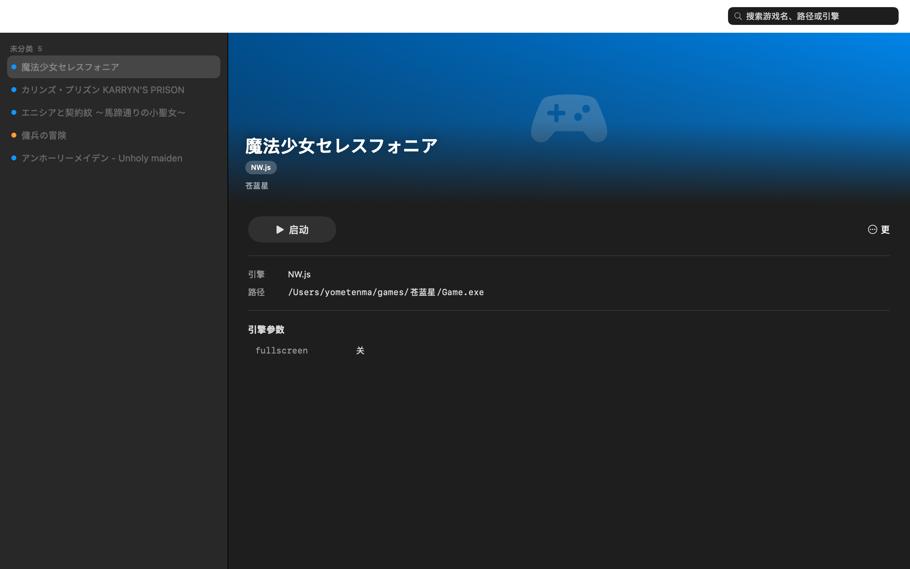
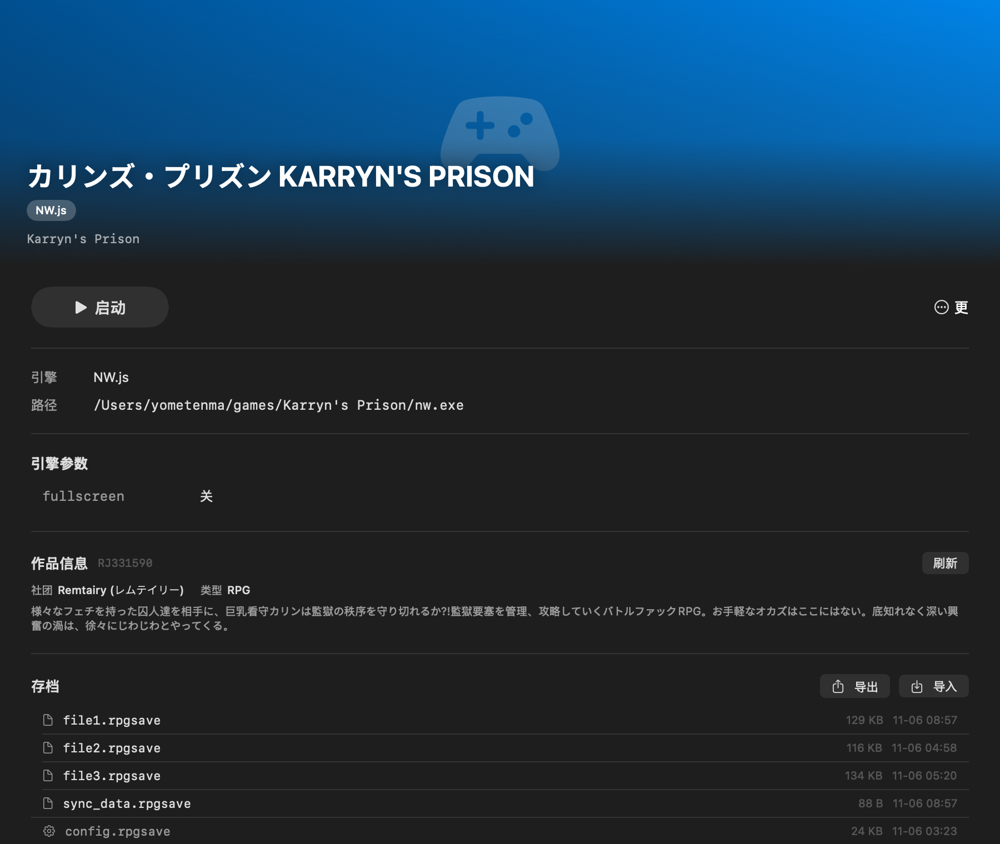
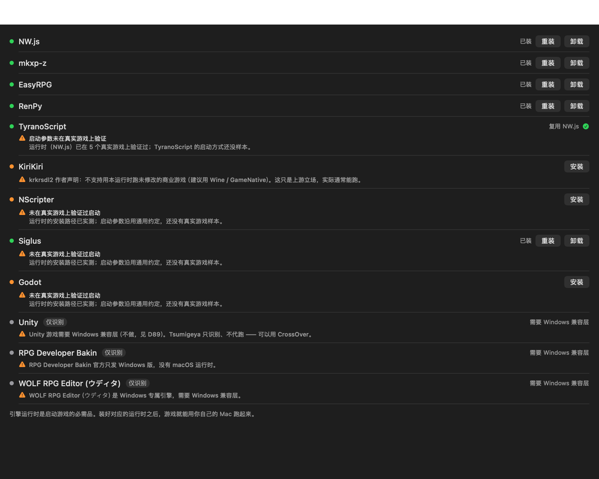

# Tsumigeya

### macOS 上的 DLsite 同人游戏启动器

把游戏文件夹拖进来，自动识别引擎、自动装运行时、一键启动。


- 支持 **9 种引擎**（RPG Maker MV/MZ/XP/VX/VX Ace、EasyRPG、Ren'Py、TyranoScript、吉里吉里、NScripter、Siglus、Godot）
- **原生 SwiftUI** —— 不是套壳，1.5 MB、内存占用低
- 全中文界面

<br clear="left">

---

## 截图



*游戏库 —— 侧边栏分组 + 详情页大图*



*详情页 —— 自动从 DLsite 抓取封面、社团、作品类型*



*引擎管理 —— 运行时状态、一键安装*

---

## 功能

**游戏库**
- 列表 / 卡片两种视图
- 搜索、自定义分类（一个游戏可以属于多个分类）
- 显示运行状态，一键关闭

**自动识别**
- 按文件结构判断引擎，不用手选
- 加错文件也会自动往上找一层

**引擎运行时**
- 缺失的运行时直接在应用内下载安装（RTP、NW.js、mkxp-z 等）
- 显示安装进度、支持重装 / 卸载

**DLsite 元数据**
- 路径里有 RJ 号（如 `RJ294126`）就自动抓取
- 识别不到就用作品名搜索，**结果列成候选让你选**（不自动选第一条）
- 也可以手动输入 RJ
- 抓到后可以改标题 / 社团 / 简介，**手改的内容刷新时不会被覆盖**

**存档管理**
- 显示存档位置与文件
- 导出成 zip，换机或重装后导入还原
- 导入前自动备份现有存档

---

## 安装

从 [Releases](https://github.com/Yometenma/Tsumigeya/releases/latest) 下载最新的 `Tsumigeya-X.Y.Z.dmg`，
双击打开，把 `Tsumigeya.app` 拖进「应用程序」。

### 首次打开

> [!IMPORTANT]
> **本应用未公证** —— 因为没有 Apple Developer 账号（$99/年）。
> macOS 会提示「无法验证开发者」，这是**缺少公证**造成的，
> 不代表应用有问题。源码完全公开，可以自己编译。

**在「应用程序」里右键点 Tsumigeya →「打开」→ 弹窗里再点一次「打开」**

之后双击就能正常开了。或者用命令行：

```bash
xattr -dr com.apple.quarantine /Applications/Tsumigeya.app
```

### 系统要求

macOS 26 或更新版本 · Apple Silicon（arm64）

---

## 使用

1. 点「添加游戏」，选游戏目录里的**任意一个文件**（不用非得是 exe）
2. 确认识别出的引擎 —— 认错了可以改
3. 如果提示缺运行时，到「引擎」页装好
4. 回到游戏库，点「启动」

---

## 支持的引擎

| 引擎 | 运行时 | 状态 |
|---|---|---|
| RPG Maker MV / MZ | NW.js | 已实测 |
| RPG Maker XP / VX / VX Ace | mkxp-z | 已实测 |
| RPG Maker 2000 / 2003 | EasyRPG | 已实测 |
| Ren'Py | Ren'Py SDK | 已实测 |
| TyranoScript | NW.js（复用） | 启动方式未实测 |
| 吉里吉里（KAG） | krkrsdl2 | 见下方说明 |
| NScripter | ONScripter | 未实测 |
| Siglus | siglus_rs | 未实测 |
| Godot | Godot 编辑器 | 未实测 |

**只识别、不代跑**（需要 Windows 兼容层如 CrossOver）：
Unity · RPG Developer Bakin · WOLF RPG Editor

> [!NOTE]
> 标「未实测」的引擎，**运行时安装路径是从真实下载包验证过的**，
> 但启动参数沿用通用约定，没有真实游戏样本跑过。
> 吉里吉里的运行时 krkrsdl2 作者声明不支持未修改的商业游戏 ——
> 这是上游的立场，实际通常能跑。

---

## 常见问题

**引擎下载失败 / 一直转圈**

下载走系统代理。浏览器能上网但应用不能的话，检查系统代理设置。

**游戏启动后黑屏或闪退**

最常见的原因是缺 RTP（运行时素材包）。到「引擎」页看运行时是否装好。

**游戏是加密的（`.rgss3a` 等归档）**

需要先解包才能运行。本应用不做这件事（涉及第三方工具与授权问题）。

**换新电脑怎么迁移**

存档：详情页「导出」打成 zip，新机器上「导入」。
游戏库和设置：数据在 `~/Library/Application Support/Tsumigeya/`，拷过去即可。

**数据目录在哪**

`~/Library/Application Support/Tsumigeya/` —— 删掉等于重置应用
（游戏本体和存档不受影响，它们在游戏自己的目录里）。

---

## 从源码构建

```bash
git clone https://github.com/Yometenma/Tsumigeya.git
cd Tsumigeya/mac-native
swift build            # 编译
swift test             # 运行测试
./scripts/package-macos.sh   # 打包成 .app 和 .dmg
```

需要 Xcode 16+ / Swift 6.2+，**只能在 macOS 上编译**。

项目结构：

```
mac-native/
├── Sources/
│   ├── TsumigeyaCore/   # 纯逻辑（识别、启动、存档、DLsite）
│   ├── TsumigeyaCLI/    # 命令行验收工具
│   └── TsumigeyaApp/    # SwiftUI 界面
└── Tests/               # 测试
```

更详细的开发说明见 [AGENTS.md](./AGENTS.md)。

---

## 许可

GPL-3.0，见 [LICENSE](./LICENSE)。

早期版本（v0.x–v1.1）是 Electron 实现，2026-11 全部重写为 SwiftUI 原生。
