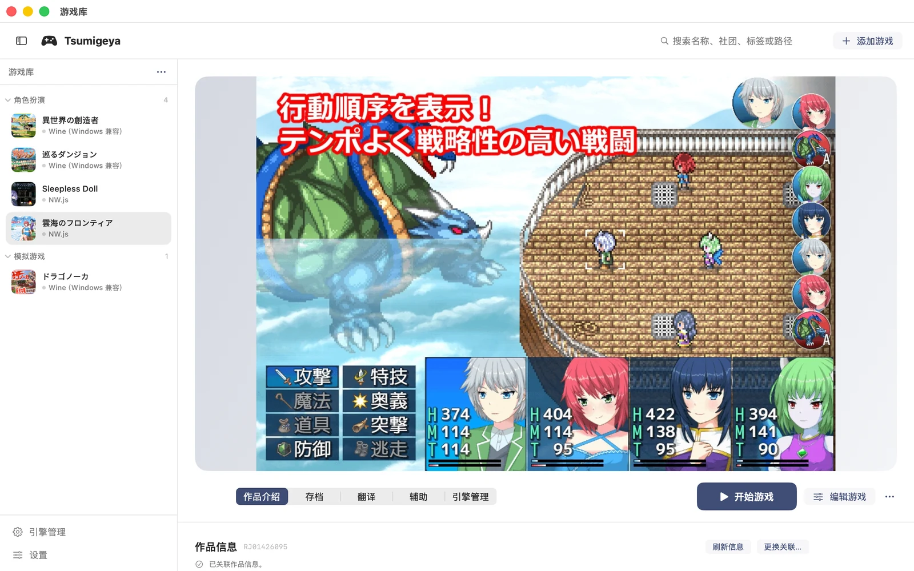
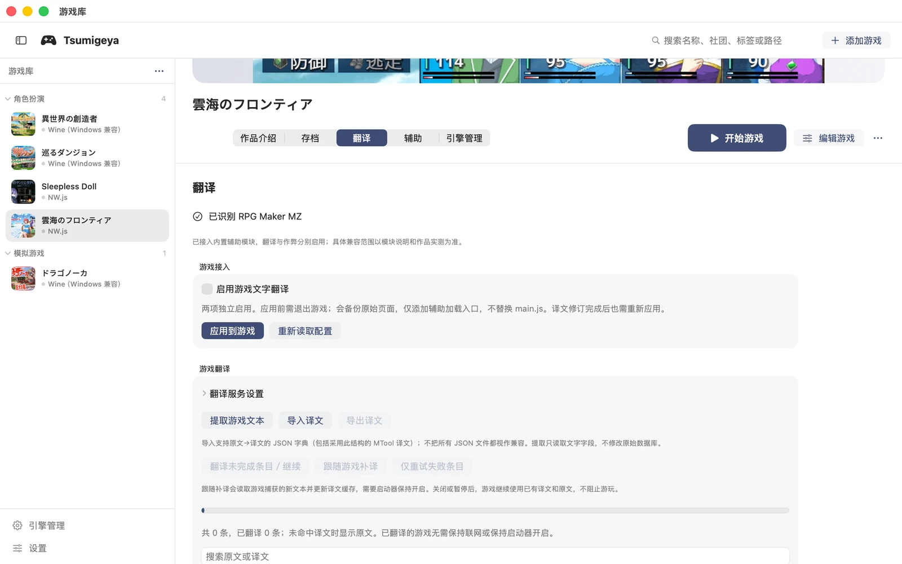

<p align="center">
  
</p>

<p align="center">
  <a href="README.md"></a>
  <a href="README.zh-CN.md"></a>
  <a href="README.ja.md"></a>
</p>

<p align="center">
  <a href="https://github.com/Yometenma/Tsumigeya/releases/latest"></a>
  
  
  
  <a href="LICENSE"></a>
  <a href="https://github.com/Yometenma/Tsumigeya/stargazers"></a>
  <br>
  <a href="https://discord.gg/kqut5fAnyk"></a>
  <a href="#community"></a>
  <a href="https://yometenma.github.io/Tsumigeya/"></a>
</p>

<p align="center">
  <b><a href="https://yometenma.github.io/Tsumigeya/">Website</a></b> ✦
  <b><a href="https://github.com/Yometenma/Tsumigeya/releases/latest">Download latest</a></b> ✦
  <a href="#compatibility">Game compatibility</a> ✦
  <a href="docs/en/faq.md">FAQ</a> ✦
  <a href="更新日志.md">Changelog</a> ✦
  <a href="CONTRIBUTING.md">Contributing</a>
</p>

<p align="center"></p>


**Tsumigeya** is a **native macOS launcher** for DLsite doujin games.

Add a game you have already downloaded and extracted to your library, and it identifies the engine, installs the matching runtime, then launches and manages everything from one place. Work info, categories, and save backups live there too, so you stop hunting through folders.

> [!NOTE]
> **It is not a general-purpose Windows emulator, and it neither sells nor downloads games.** Whether a game runs depends on its engine, scripts, plugins, and runtime compatibility; successful detection does not mean every work will run.

<br clear="right">

<p align="center">
  
</p>
<p align="center"><sub>Real interface (light theme). Demo screen: 『雲海のフロンティア』 trial version © New RPG Project</sub></p>

<a id="highlights"></a>

## ✦ Recent updates

**v3.1.7**

- The cheat panel is now a list-and-detail layout: items, armor, and weapons are tabbed straight from the game database, ticking a row locks it, counts step by ±1／±100 or bulk-set per tab, and a new object browser inspects and edits values by path.
- Translation now runs in batches of 12, cutting a 2000-entry job from hours to minutes; a hot path that made cutscenes stutter is fixed.
- Offline assistance: without injecting into the game, NScripter scripts can be extracted and rewritten (keeping the original encoding), and RPG Maker MZ／XP／VX／VX Ace saves can be edited, with automatic backups. RPG Maker 2000／2003 database text can be extracted but not yet written back.

[Download v3.1.7 and read the release notes](https://github.com/Yometenma/Tsumigeya/releases/tag/v3.1.7) · [Getting game info](docs/en/game-info.md) · [Full changelog](更新日志.md)

<a id="features"></a>

## ✦ What it does

<table>
  <tr>
    <td width="50%" valign="top">
      <br>
      <b>📚 Turn your games into a shelf of your own</b><br>
      <sub>Browse from the sidebar with full details, search, custom categories, and multi-category assignment. Point it at an extracted collection folder, review the results, and add games in bulk.</sub>
    </td>
    <td width="50%" valign="top">
      <br>
      <b>⚙️ Less runtime busywork</b><br>
      <sub>Engines are detected from the file layout. Install and manage runtimes in one place, and check launch status and engine arguments. Games keep running after you quit the launcher.</sub>
    </td>
  </tr>
  <tr>
    <td width="50%" valign="top">
      <br>
      <b>🔍 Fill in work info</b><br>
      <sub>Find DLsite works by title, RJ code, or work URL, with adult and all-ages works in the same search. Cover, full description, release date, series, tags, languages, staff and cast, and preview screenshots are shown as the work page provides them. Preview before linking; manual edits survive refreshes.</sub>
    </td>
    <td width="50%" valign="top">
      <br>
      <b>🈳 Translation and assist</b><br>
      <sub>RPG Maker MV/MZ, XP/VX/VX Ace, Ren’Py, and Tyrano share translation management and a choose-your-own AI endpoint, while each engine connects its own way to display text, edit values, lock them, and filter by value. Capabilities and verification differ per engine: launch support is not assist support. Back up your saves first, and see <a href="docs/en/translation-and-cheats.md">the guide</a>.</sub>
    </td>
  </tr>
</table>

- **Bulk fill**: fill game info for the current filter scope, handling saved, pending, and failed items separately.
- **Local image and info cache**: downloaded covers and preview images are read locally first, and text info is held in memory so refreshing the interface no longer reads files every time.
- **Back up game progress**: for engines whose save location is implemented, export the save folder as a ZIP and restore from it. Imports validate files and back up existing ones; import and export are disabled while the game is running.

<a id="install"></a>

## ✦ Download and install

> [!IMPORTANT]
> Requires **macOS 26** or later and an **Apple Silicon** chip. No Intel build is available.

1. Open the **[latest release](https://github.com/Yometenma/Tsumigeya/releases/latest)** and download `Tsumigeya-<version>.dmg` from the assets.
2. Open the DMG and drag `Tsumigeya.app` into Applications. Quit the old version before updating.
3. Open Tsumigeya and follow the steps below to add a game.

For release notes, installation requirements, and known limitations, see the [releases](https://github.com/Yometenma/Tsumigeya/releases). `SHA256SUMS.txt` in the release assets verifies that your download is intact.

<details>
<summary><b>🔒 Blocked by macOS on first launch?</b></summary>
<br>

The current package is only **ad-hoc signed: it is not notarized by Apple** and carries no Developer ID distribution signature. macOS may block the first launch.

Only after you confirm the package comes from this repository and you trust the source, you can run this against the installed app in Terminal:

```bash
xattr -dr com.apple.quarantine /Applications/Tsumigeya.app
```

Then open the app again. This only removes the download quarantine flag for that app; **do not turn off system-wide security**. See the [FAQ](docs/en/faq.md#first-launch) for details.

</details>

<a id="first-game"></a>

## ✦ Add your first game

1. **Extract the game first.** Keep the whole folder; do not move a single `.exe` out of it.
2. **Add it to the library.** Click Add Game (「添加游戏」) or press `⌘O`, pick any file inside the game folder (such as a `.exe` or `.app`), and confirm the detected engine and folder.
3. **Prepare the runtime.** If dependencies are reported missing, install the matching module on the Engine Management (「引擎管理」) page, then go back to the library and launch.
4. **Fill in work info.** On the detail page click Find Work… (「查找作品…」) and enter a title, an RJ code, or paste a work URL; check the candidates and the preview before linking. Once linked you can refresh the info or change the work; the library name does not change on its own.

A game's details are split into Info (「作品介绍」), Saves (「存档」), Translation (「翻译」), Assist (「辅助」), and Engine Management (「引擎管理」). When a launch fails, check runtime status, game path, and engine arguments first. Exporting and importing saves happen on the Saves tab. The More (「更多」) menu also opens launch diagnostics, which checks the game folder, the engine runtime, execute permission, and the final launch plan item by item; diagnostics never performs the writes that launching does.

<details>
<summary><b>🗂 Automatic and manual categories</b></summary>
<br>

After you save work info, the game is filed under Role-Playing, Adventure, Simulation, Action, or Puzzle by its confirmed type; genre tags stay in the work info and are not mixed into the top-level categories. Viewing a preview alone changes nothing, and existing info takes part in sorting the next time the library loads, with no need to go online again. Missing or unknown types are never guessed, and you can still sort by hand.

In Edit Game (「编辑游戏」) → Categories (「分类」) you can tick or remove assignments; changes save immediately, and later refreshes or work changes keep your manual adjustments. Existing categories and assignments are never cleared; Restore Auto Categories (「恢复自动分类」) asks for confirmation, then clears this game's manual adjustments and re-files it by the current work type. Type categories can be renamed, and deleting one is not undone by a refresh; creating a new category with the same default name re-enables it.

</details>

<details>
<summary><b>🌐 Info languages and other games</b></summary>
<br>

Settings (「设置」) → Game Info (「作品信息」) sets the preferred and fallback languages for scraping; DLsite is cached per language, so after switching you can manually refresh existing info. For games that are not on DLsite, choose Other game · AI／manual (「其他游戏 · AI／手动」) in the find window: hand an official site or store page to AI, use a separate Tavily／SearXNG／custom search (or keep the native Responses search) to look for candidates first, or type everything in by hand.

Every external record is previewed and its fields selected before you confirm, keeping sources and checkable quotes: RJ codes are never invented, game files are never uploaded automatically, and the key stays separate from the translation one. A plain chat model can be paired with a separate search; LAN HTTP models and search endpoints each need their own authorization, which is revoked automatically when the address changes. You can tune local model timeout, body length, and compatibility options; bulk fill never calls paid AI on its own. See [Getting game info](docs/en/game-info.md).

</details>

<details>
<summary><b>📦 Bulk fill game info</b></summary>
<br>

Bulk Fill Game Info (「批量补全作品信息」) in the Game Library (「游戏库」) sidebar menu handles the current filter scope. By default it fills unlinked games, and you can also refresh existing info while keeping manual edits. A single unique RJ code is fetched automatically; name searches and multiple codes must be previewed and confirmed one by one, and the first result is never picked for you. You can pause and resume and retry failures in one go; saved items are not rolled back when the panel closes. The task list is not preserved after you quit the app, so the list can be prepared again.

</details>

<details>
<summary><b>🚚 Bulk add, and games that moved</b></summary>
<br>

Bulk Add (「批量入库」) in the same Game Library (「游戏库」) sidebar menu lets you choose an extracted game collection folder, review engines, fix duplicate titles, tick items one by one, and save once. It never selects everything automatically, downloads runtimes, or links DLsite works. The same folder cannot be added twice; for Windows programs you confirm the real launch executable.

Scanning goes at most three levels deep, over 2000 folders and 200 candidates, does not follow subfolder symlinks, and stops descending into a folder once a game is detected. Reaching a limit or hitting an unreadable folder is reported, and the candidate list must not be treated as a full disk index. For missed games, narrow the scan folder or use Add Game.

After moving a game, choose Relocate Game Folder… (「重新定位游戏目录…」) in the detail's More menu, pick the new folder, and confirm it is the same game. The engine must match the existing record, and the path cannot be changed while the game is running. This only updates the library path and keeps the id, work info, categories, play stats, and arguments; **it does not move game files or saves**. If the saves moved as well, check or re-point the save folder on the Saves tab.

</details>

<a id="compatibility"></a>

## ✦ Game compatibility

The table below shows the launch paths available today. Real tests only cover the samples that were tested; they are not a guarantee for every work on the same engine.

🟢 Real game launch recorded　🟡 Partially verified / experimental　⚪ Wired up, not yet launch-tested　🔵 Needs per-work testing

| Engine | Runtime used | Current verification scope |
|---|---|---|
| RPG Maker MV / MZ | NW.js | 🟢 Real game launch recorded |
| RPG Maker XP / VX / VX Ace | mkxp-z | 🟢 Real game launch recorded |
| RPG Maker 2000 / 2003 | EasyRPG | 🟢 Real game launch recorded |
| Ren'Py | Ren'Py SDK | 🟢 Real game launch recorded |
| TyranoScript | NW.js | 🟡 Official V5 sample and original scripts of free works verified for translation and variable editing; Electron builds need separate adaptation and do not run as-is |
| KiriKiri / KAG | krkrsdl2 | 🟡 Experimental, commercial game compatibility not guaranteed |
| NScripter | ONSyuri | 🟢 Real game launch recorded |
| Siglus | siglus_rs | ⚪ Wired up, game launch not yet tested |
| Godot | Godot editor | ⚪ Wired up, game launch not yet tested |
| Windows programs (PE `.exe`) | Wine | 🔵 32-bit and 64-bit Minesweeper windows and console programs tested; individual works still need testing |

Windows programs run in a separate environment through Wine. It is not a security sandbox and does not make every program compatible; drivers, anti-cheat, DRM, unusual graphics APIs, and missing dependencies can all fail. Each game's Windows environment and runtime are stored separately, and uninstalling Wine does not delete those environments. Old records for Unity, RPG Developer Bakin, and WOLF RPG Editor are read through Wine and no longer appear as separate "detection only" engines.


Also note:

- TyranoScript and KiriKiri never guess save locations; set the folder by hand on the Saves tab. Setting a folder does not move files; a confirmed folder can be revealed in Finder or copied as a full path; a folder that no longer exists still shows as "location unknown", and clearing it restores auto detection.
- Saves are local manual import and export only, with **no cloud sync**; a valid but empty folder shows as "no saves yet" and stays distinct from an unknown location.
- The save folder cannot be changed, imported, or exported while the game is running.
- **The interface is available in Simplified Chinese, English and Japanese** (Settings → Language), and follows the system language by default.

> [!TIP]
> Hitting a compatibility problem with a specific work? [File a compatibility report](https://github.com/Yometenma/Tsumigeya/issues/new?template=compatibility.yml) or post in the [Discord "compatibility reports" forum](https://discord.gg/kqut5fAnyk) with the engine, game version, and reproduction steps. Please do not upload commercial game data or private saves.

<br clear="right">

<a id="data"></a>

## ✦ Where your data lives

<details>
<summary><b>💾 App data, caches, and save locations</b></summary>
<br>

The library, categories, settings, cached work info, and runtimes live in:

```text
~/Library/Application Support/Tsumigeya/
```

Rebuildable cover and preview image caches live separately in `~/Library/Caches/Tsumigeya/Artwork/`; after the system clears its caches, images that are no longer in memory are downloaded again. Images and text info are never written into game folders.

**Real game saves are not necessarily in that folder.** Save locations depend on the game and the engine; check the Saves tab in the game's details. Before migrating, quit the launcher and the related games, and back up app data, game folders, and saves separately; copying the app data folder is no substitute for backing up saves.

</details>

For more on installation, backups, networking, and launching, see the **[FAQ](docs/en/faq.md)**.

<a id="community"></a>

## ✦ Community

- 💬 **Discord**: [discord.gg/kqut5fAnyk](https://discord.gg/kqut5fAnyk) — compatibility reports forum, game recommendations, tester recruiting
- 🐧 **QQ group**: **1134670666** — usage chat and compatibility reports ([scan to join](website/assets/img/qq-group-qr.png))
- 🐞 **Issues**: [report a problem or suggest a feature](https://github.com/Yometenma/Tsumigeya/issues/new/choose)
- 🌐 **Website**: [yometenma.github.io/Tsumigeya](https://yometenma.github.io/Tsumigeya/)

<a id="development"></a>

## ✦ Contributing

Issues, documentation improvements, compatibility reports, and code are all welcome. For larger features or architectural changes, please open an Issue first.

The app uses Swift 6.2+ with the matching macOS SDK. From the repository root:

```bash
cd mac-native
swift build
swift test
```

Before running the app, set up a separate development data folder as described in the [contributing guide](CONTRIBUTING.md#搭建开发环境), so debugging does not rewrite your everyday game library.

- [Contributing guide](CONTRIBUTING.md): environment setup, layout, CLI, data safety, and pre-commit checks.
- [UI verification](docs/UI验收方法.md): how snapshots, real windows, and interaction checks differ.
- [Packaging and distribution](docs/打包与分发.md): DMG packaging, signing, and pre-release checks.

<sub>These development documents are currently written in Chinese only. The user-facing docs are also available in English and Japanese: [FAQ](docs/en/faq.md) · [Getting game info](docs/en/game-info.md) · [Translation and cheats](docs/en/translation-and-cheats.md).</sub>

<a id="license"></a>

## ✦ License and credits

Tsumigeya is released under [GPL-3.0](LICENSE). Games, their assets, and third-party runtimes keep their own licenses; using this project does not change them.

Thanks to NW.js, mkxp-z, EasyRPG, Ren'Py, and the other runtime projects for the foundation, and to everyone who reported compatibility issues, tested, and improved things. The pixel sign images in this README are generated by `scripts/make-readme-signs.py`, using [Fusion Pixel Font](https://github.com/TakWolf/fusion-pixel-font) (SIL OFL 1.1).

Tsumigeya is an independent open-source project and is not affiliated with DLsite. The maintained version is the native SwiftUI app; the old Electron implementation is still visible in Git history.

<p align="center"></p>

<p align="center">
  <br>
  <sub>If Tsumigeya helps you keep your games in order, a ⭐ is the best encouragement~</sub>
</p>
