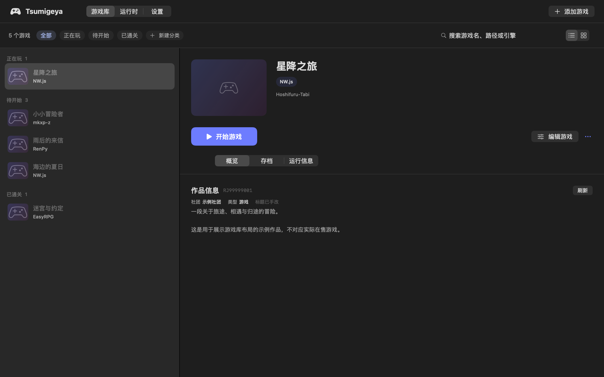

# Tsumigeya

macOS 上的中文 DLsite 游戏启动器，使用 SwiftUI 构建。添加游戏后，按文件结构识别引擎、安装运行时并启动；提供分类、搜索、DLsite 元数据和存档导入导出。



## 安装与使用

要求 **macOS 26+、Apple Silicon**。从 [Releases](https://github.com/Yometenma/Tsumigeya/releases) 下载 DMG，将应用拖入「应用程序」。

应用仅做 ad-hoc 签名，**未公证**。若首次打开被系统拦截，仅在确认下载来源可信后移除隔离标记：

```bash
xattr -dr com.apple.quarantine /Applications/Tsumigeya.app
```

1. 点「添加游戏」，选择游戏目录内的文件，确认引擎。
2. 到「运行时」页安装缺失依赖，再回游戏库启动。
3. 在详情页编辑作品信息、管理存档。DLsite 搜索结果需手动选择；手改字段刷新时保留。

## 引擎支持

| 游戏引擎 | 运行时 | 验证范围 |
|---|---|---|
| RPG Maker MV / MZ | NW.js | 已实测启动 |
| RPG Maker XP / VX / VX Ace | mkxp-z | 已实测启动 |
| RPG Maker 2000 / 2003 | EasyRPG | 已实测启动 |
| Ren'Py | Ren'Py SDK | 已实测启动 |
| TyranoScript | NW.js | 未实测启动 |
| 吉里吉里 | krkrsdl2 | 未保证商业游戏兼容性 |
| NScripter | ONScripter | 未实测启动 |
| Siglus | siglus_rs | 未实测启动 |
| Godot | Godot 编辑器 | 未实测启动 |

Unity、RPG Developer Bakin、WOLF RPG Editor 仅识别，不代为启动。TyranoScript、吉里吉里的存档位置尚未实现。

## 数据与排障

- 数据目录：`~/Library/Application Support/Tsumigeya/`，包含游戏库、设置、元数据及运行时。迁移时退出应用后复制该目录；游戏本体与存档另行迁移。
- 存档：详情页导出为 ZIP，在新机器导入；导入前自动备份，游戏运行时不能导入导出。
- 下载失败：检查系统网络与代理。启动失败：先检查运行时、RTP 和引擎兼容性，不要仅凭黑屏判断原因。

## 开发与贡献

只在 macOS 上构建，需要 Swift 6.2+ 及匹配的 macOS SDK：

```bash
cd mac-native
swift build
swift test
bash scripts/package-macos.sh
```

- [贡献指南：开发环境、CLI 与修改约定](CONTRIBUTING.md)
- [UI 验收](docs/UI验收方法.md)
- [打包与分发](docs/打包与分发.md)

GPL-3.0，见 [LICENSE](LICENSE)。旧 Electron 实现在 Git 历史中。
