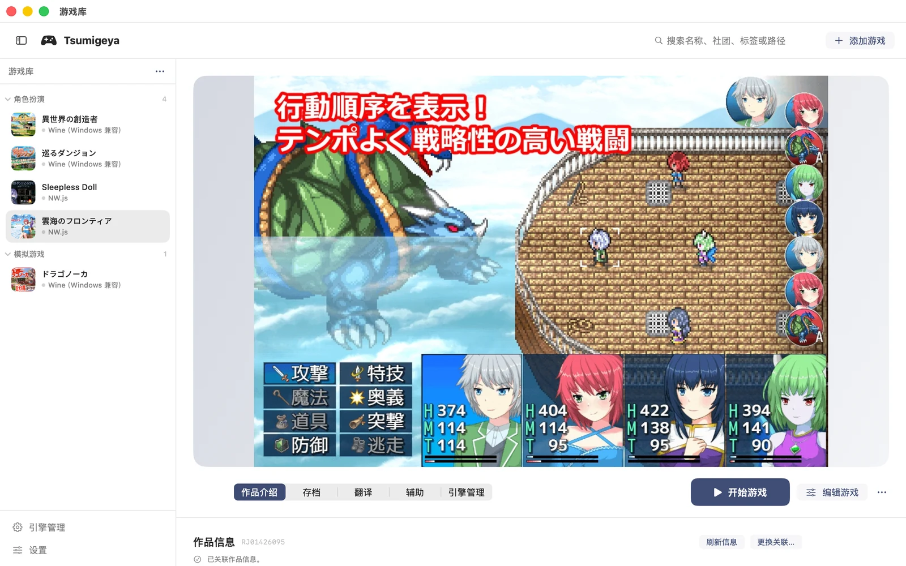
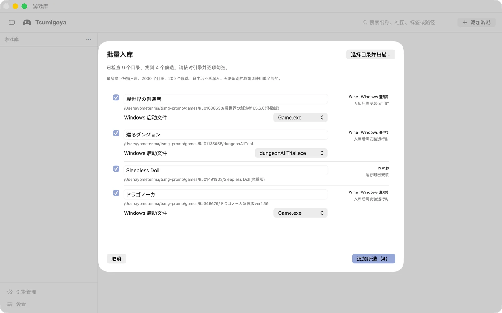
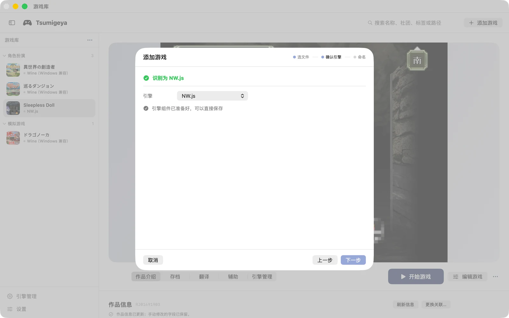
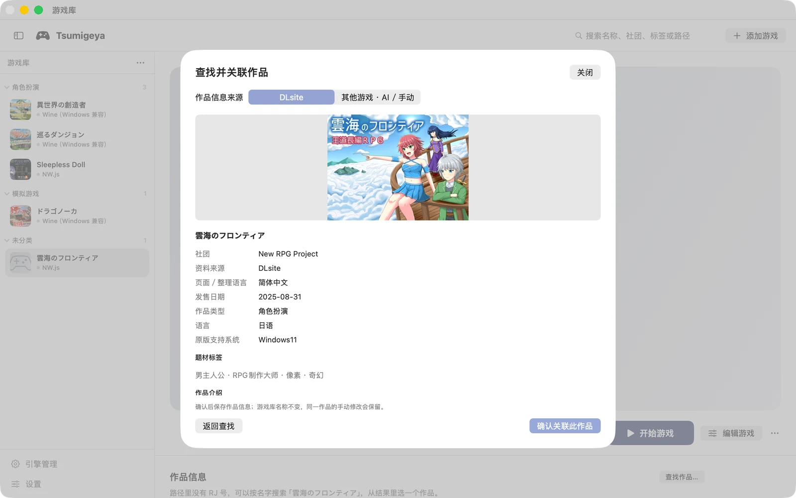
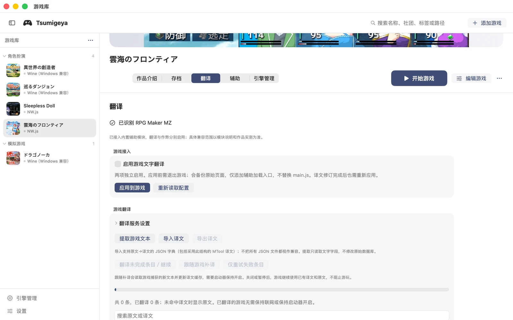

<p align="center">
  
</p>

<p align="center">
  <a href="README.md"></a>
  <a href="README.zh-CN.md"></a>
  <a href="README.ja.md"></a>
</p>

<p align="center">
  <a href="https://github.com/Yometenma/Tsumigeya/releases/latest"></a>
  
  
  
  <a href="LICENSE"></a>
  <a href="https://github.com/Yometenma/Tsumigeya/stargazers"></a>
  <br>
  <a href="https://discord.gg/kqut5fAnyk"></a>
  <a href="#community"></a>
  <a href="https://yometenma.github.io/Tsumigeya/"></a>
</p>

<p align="center">
  <b><a href="https://yometenma.github.io/Tsumigeya/">官网</a></b> ✦
  <b><a href="https://github.com/Yometenma/Tsumigeya/releases/latest">下载最新版</a></b> ✦
  <a href="#compatibility">游戏兼容性</a> ✦
  <a href="docs/常见问题.md">常见问题</a> ✦
  <a href="更新日志.md">更新日志</a> ✦
  <a href="CONTRIBUTING.md">参与贡献</a>
</p>

<p align="center"></p>


**Tsumigeya** 是一款面向 DLsite 同人游戏的**原生 macOS 启动器**。

把已经下载、解压的游戏加入游戏库，它会帮你识别引擎、安装对应运行时，再从同一个地方启动和管理。作品信息、分类和存档备份也放在一起，不必在文件夹之间来回寻找。

> [!NOTE]
> **它不是通用的 Windows 模拟器，也不提供游戏购买或下载。** 能否运行取决于游戏引擎、脚本、插件和运行时的兼容性；识别成功不代表每部作品都能正常运行。

<br clear="right">

<p align="center">
  
</p>
<p align="center"><sub>真实界面（浅色主题）。演示画面：『雲海のフロンティア』体験版 © New RPG Project</sub></p>

<a id="highlights"></a>

## ✦ 最近更新

**v3.1.7**

- 作弊面板改成主从三栏：物品／防具／武器按数据库自动分栏，行首勾选即锁定，数量支持 ±1／±100 步进和整栏批量设置，并新增按路径查看与改写对象的「对象浏览」。
- 翻译改为批量请求（一次 12 条），2000 条的作业从按小时降到按十分钟；同时修掉会让剧情节卡的捕获热路径。
- 新增离线辅助：不注入运行时，直接读写游戏文件。NScripter 可提取并替换脚本正文（保留原编码），RPG Maker MZ 与 XP／VX／VX Ace 可改存档数值，写前自动备份。RPG Maker 2000／2003 可提取数据库文本，暂不支持写回。

[下载 v3.1.7 与查看更新说明](https://github.com/Yometenma/Tsumigeya/releases/tag/v3.1.7) · [作品信息获取](docs/作品信息获取.md) · [完整更新日志](更新日志.md)

<a id="features"></a>

## ✦ 能做什么

<table>
  <tr>
    <td width="50%" valign="top">
      <br>
      <b>📚 把游戏整理成自己的书架</b><br>
      <sub>侧边栏浏览与详情展示，支持搜索、自定义分类，一部作品可归入多个分类。扫描已解压的游戏集合目录，核对后批量入库。</sub>
    </td>
    <td width="50%" valign="top">
      <br>
      <b>⚙️ 少处理一些运行环境</b><br>
      <sub>按文件结构识别引擎，集中安装和管理运行时，查看启动状态与引擎参数。退出启动器后，游戏仍可继续运行。</sub>
    </td>
  </tr>
  <tr>
    <td width="50%" valign="top">
      <br>
      <b>🔍 补齐作品信息</b><br>
      <sub>通过作品名、RJ 编号或作品链接查找 DLsite，统一查找成人向与全年龄作品。展示封面、完整介绍、发售日期、系列、标签、语言、制作／配音及预览截图（以作品页提供的信息为准）。先预览再确认关联，手改字段刷新时保留。</sub>
    </td>
    <td width="50%" valign="top">
      <br>
      <b>🈳 翻译与辅助</b><br>
      <sub>RPG Maker MV/MZ、XP/VX/VX Ace、Ren’Py 与 Tyrano 共用译文管理和自选 AI 接口，各自通过引擎接入显示文字、编辑数值、锁定及数值筛选；具体功能和验证范围因引擎而异，启动支持不等于辅助支持。使用前请备份存档，详见<a href="docs/翻译与作弊.md">使用说明</a>。</sub>
    </td>
  </tr>
</table>

- **批量补全**：按当前筛选范围补全作品资料，分别处理已保存、待确认与失败项目。
- **本地图片与资料缓存**：已下载的封面和预览图优先本地读取；作品文字资料加载到内存，界面刷新不再逐次读文件。
- **备份游戏进度**：对已实现存档定位的引擎，导出存档目录为 ZIP，并从备份恢复。导入前校验文件并备份原文件；游戏运行时禁用导入和导出。

<a id="install"></a>

## ✦ 下载与安装

> [!IMPORTANT]
> 需要 **macOS 26** 或更新版本，以及 **Apple Silicon** 芯片。当前不提供 Intel 安装包。

1. 前往 **[最新版本](https://github.com/Yometenma/Tsumigeya/releases/latest)**，在附件中下载 `Tsumigeya-<版本号>.dmg`。
2. 打开 DMG，将 `Tsumigeya.app` 拖入「应用程序」。更新旧版前，请先退出应用。
3. 打开 Tsumigeya，按下方步骤添加游戏。

版本更新、安装要求与已知限制见 [发布记录](https://github.com/Yometenma/Tsumigeya/releases)。发布附件中的 `SHA256SUMS.txt` 可用于检查下载是否完整。

<details>
<summary><b>🔒 首次打开被 macOS 拦截？</b></summary>
<br>

当前安装包仅做 **ad-hoc 签名，未经过 Apple 公证**，也没有 Developer ID 分发签名。macOS 可能阻止首次打开。

仅在确认安装包来自本仓库且信任来源后，可在终端对已安装应用执行：

```bash
xattr -dr com.apple.quarantine /Applications/Tsumigeya.app
```

然后重新打开应用。这个操作只移除该应用的下载隔离标记，**不要关闭系统整体安全保护**。更详细的说明见 [常见问题](docs/常见问题.md#first-launch)。

</details>

<a id="first-game"></a>

## ✦ 添加你的第一部游戏

1. **先解压游戏**。保留完整目录，不要只把 `.exe` 文件单独移出来。
2. **添加到游戏库**。点击「添加游戏」或按 `⌘O`，选择游戏目录内的任意文件（如 `.exe` 或 `.app`），确认识别出的引擎和目录。
3. **准备运行时**。如果提示依赖缺失，前往「引擎管理」页面安装对应模块，再回游戏库启动。
4. **补充作品信息**。在详情页点击「查找作品…」，输入作品名、RJ 编号或粘贴作品链接；核对候选和预览后确认关联。关联后可刷新信息或更换作品，游戏库名称不会自动改变。

游戏详情按「作品介绍」「存档」「翻译」「辅助」「引擎管理」分栏。启动失败时，先查看运行时状态、游戏路径和引擎参数；存档的导出与导入在「存档」页操作。详情的「更多」菜单还可以打开启动诊断，逐项检查游戏目录、引擎运行时、执行权限和最终启动计划；诊断不会执行启动准备写入。

<details>
<summary><b>🗂 自动分类与手动整理</b></summary>
<br>

保存作品信息后，按已识别的游戏类型自动归入「角色扮演」「冒险游戏」「模拟游戏」「动作游戏」或「益智游戏」；题材标签保留在作品信息中，不混入主分类。仅查看预览不会改变分类；已有资料在下次加载游戏库时参与归类，无需重新联网。缺失或未知类型不猜测，仍可手动整理。

在「编辑游戏 → 分类」中可勾选或移除归属，修改立刻保存，之后刷新或更换作品仍保留人工调整。原有分类和归属不会清空；「恢复自动分类」需要确认，会清除这个游戏的人工调整并按当前作品类型重新归类。类型分类可以改名，删除后不会在刷新资料时自动重建；新建同名的默认类型分类可重新启用。

</details>

<details>
<summary><b>🌐 资料语言与其他游戏</b></summary>
<br>

「设置 → 作品信息」可指定刮削优先／回退语言；DLsite 按语言独立缓存，切换后可手动刷新已有资料。不在 DLsite 上的游戏，可在查找窗口选择「其他游戏 · AI／手动」：指定官网／商店页交给 AI 整理，或使用独立 Tavily／SearXNG／自定义搜索（也可保留 Responses 原生搜索）先查候选，也可以完全手动填写。

所有外部资料先预览、选字段再确认，保留来源与可核对引文，不伪造 RJ、不自动上传游戏文件，不与游戏翻译共用密钥。普通聊天模型可搭配独立搜索；局域网 HTTP 模型／搜索接口需分别授权，修改地址自动撤销。可调整本地模型等待、正文长度及兼容选项；批量补全不自动调用付费 AI。详见 [作品信息获取](docs/作品信息获取.md)。

</details>

<details>
<summary><b>📦 批量补全作品信息</b></summary>
<br>

侧边栏「游戏库」右侧菜单中的「批量补全作品信息」处理当前筛选范围。默认补全未关联游戏，也可刷新已有信息，并保留手动修改。唯一 RJ 自动获取；名称搜索和多个编号必须逐项预览确认，不自动选首条。可暂停继续、集中重试失败项；已保存项目不会因关闭补全窗口而撤销。退出应用后任务清单不保留，可重新准备列表。

</details>

<details>
<summary><b>🚚 批量入库与移动后的游戏</b></summary>
<br>

侧边栏「游戏库」右侧菜单提供「批量入库」：选择已解压的游戏集合目录，扫描后核对引擎、修改重名标题并逐项勾选，再一次保存。不会自动全选、下载运行时或关联 DLsite 作品。相同目录不能重复入库；Windows 程序需确认实际启动文件。

扫描最多向下三层、2000 个目录、200 个候选，不跟随子目录符号链接；识别到游戏后不再深入资源目录。达到范围上限或遇到不可读目录会提示，不能把候选列表当作完整磁盘索引。漏掉的游戏可缩小扫描范围，或使用「添加游戏」。

游戏移动后，在详情的更多菜单选择「重新定位游戏目录…」，选择新目录并确认是同一游戏。引擎必须与原记录相符；运行中不能更改路径。此操作只更新游戏库路径，保留编号、作品信息、分类、游玩记录和参数，**不会搬移游戏文件或存档**。如存档也已移动，请在「存档」页核对或重新指定存档目录。

</details>

<a id="compatibility"></a>

## ✦ 游戏兼容性

下表说明当前可用的启动路径。真实实测只代表测试过的样本，不是对同一引擎全部作品的保证。

🟢 有真实游戏启动记录　🟡 部分验收／实验性　⚪ 已接入，尚未实测　🔵 需按作品实测

| 游戏引擎 | 使用的运行时 | 当前验证范围 |
|---|---|---|
| RPG Maker MV / MZ | NW.js | 🟢 有真实游戏启动记录 |
| RPG Maker XP / VX / VX Ace | mkxp-z | 🟢 有真实游戏启动记录 |
| RPG Maker 2000 / 2003 | EasyRPG | 🟢 有真实游戏启动记录 |
| Ren'Py | Ren'Py SDK | 🟢 有真实游戏启动记录 |
| TyranoScript | NW.js | 🟡 官方 V5 样本及免费作品原剧本已验收翻译／变量编辑；Electron 下载包需另行适配，不能直接运行 |
| 吉里吉里 / KAG | krkrsdl2 | 🟡 实验性，不保证商业游戏兼容性 |
| NScripter | ONSyuri | 🟢 有真实游戏启动记录 |
| Siglus | siglus_rs | ⚪ 已接入，尚未实测游戏启动 |
| Godot | Godot 编辑器 | ⚪ 已接入，尚未实测游戏启动 |
| Windows 程序（PE `.exe`） | Wine | 🔵 已实测 32／64 位扫雷窗口及控制台程序；具体作品仍需实测 |

Windows 程序通过 Wine 在独立环境中运行。它不是安全沙盒，也不保证所有程序兼容；驱动、反作弊、DRM、特殊图形接口和缺失依赖可能失败。每个游戏的 Windows 环境与运行时分开保存，卸载 Wine 不会删除这些环境。Unity、RPG Developer Bakin、WOLF RPG Editor 的旧记录会按 Wine 读取，不再作为单独的“仅识别”引擎展示。


另外请留意：

- TyranoScript 和吉里吉里不会自动猜测存档位置；在详情的「存档」页可手动指定目录。指定目录不会移动文件；已确定的目录可直接在访达中显示或复制完整路径，失效目录仍显示为“位置未知”，清除后恢复自动探测。
- 存档只提供本地手动导入、导出，**没有云同步**；有效的空目录会显示为“还没有存档”，并与未知位置区分。
- 游戏运行中不能更改存档目录，也不能导入导出。
- **界面支持简体中文、英文与日文**（设置 → 语言），默认跟随系统语言。

> [!TIP]
> 遇到特定作品的兼容性问题，欢迎 [提交兼容性反馈](https://github.com/Yometenma/Tsumigeya/issues/new?template=compatibility.yml)，或在 [Discord 的「兼容性反馈」论坛](https://discord.gg/kqut5fAnyk) 发帖，附上引擎、游戏版本和复现步骤即可；请勿上传商业游戏本体或私人存档。

<br clear="right">

<a id="data"></a>

## ✦ 数据放在哪里

<details>
<summary><b>💾 应用数据、缓存与存档位置</b></summary>
<br>

游戏库、分类、设置、作品信息缓存及运行时保存在：

```text
~/Library/Application Support/Tsumigeya/
```

封面和预览图的可重建缓存单独保存在 `~/Library/Caches/Tsumigeya/Artwork/`；系统清理缓存后，未在内存中的图片需要重新下载。图片和文字资料不会写入游戏目录。

**真实游戏存档不一定在这个目录中。** 存档位置取决于游戏和引擎，请在详情的「存档」页查看。迁移前先退出启动器和相关游戏，分别备份应用数据、游戏目录及存档；只复制应用数据目录不能替代存档备份。

</details>

更多安装、备份、网络和启动问题见 **[常见问题](docs/常见问题.md)**。

<a id="community"></a>

## ✦ 社区

- 💬 **Discord**：[discord.gg/kqut5fAnyk](https://discord.gg/kqut5fAnyk)，兼容性反馈论坛、游戏安利、测试员招募
- 🐧 **QQ 群**：**1134670666**，使用交流与兼容性反馈（[扫码加入](website/assets/img/qq-group-qr.png)）
- 🐞 **Issues**：[报告问题或提出建议](https://github.com/Yometenma/Tsumigeya/issues/new/choose)
- 🌐 **官网**：[yometenma.github.io/Tsumigeya](https://yometenma.github.io/Tsumigeya/)

<a id="development"></a>

## ✦ 参与开发

欢迎提交问题、文档改进、兼容性记录和代码。较大功能或架构调整，建议先开 Issue 讨论。

使用 Swift 6.2+ 及匹配的 macOS SDK，在仓库根目录执行：

```bash
cd mac-native
swift build
swift test
```

运行应用前，建议按 [贡献指南](CONTRIBUTING.md#搭建开发环境) 设置独立开发数据目录，避免调试改写日常游戏库。

- [贡献指南](CONTRIBUTING.md)：环境配置、目录结构、CLI、数据安全和提交检查。
- [UI 验收方法](docs/UI验收方法.md)：快照、真实窗口和交互验证的区别。
- [打包与分发](docs/打包与分发.md)：DMG 打包、签名及发布前检查。

<a id="license"></a>

## ✦ 许可与致谢

Tsumigeya 以 [GPL-3.0](LICENSE) 发布。游戏本体、素材和第三方运行时不因使用本项目而改变其原有许可。

感谢 NW.js、mkxp-z、EasyRPG、Ren'Py 及其他运行时项目提供的基础，也感谢贡献兼容性反馈、测试和改进的使用者。README 中的像素举牌图由 `scripts/make-readme-signs.py` 生成，文字使用 [Fusion Pixel Font](https://github.com/TakWolf/fusion-pixel-font)（SIL OFL 1.1）。

Tsumigeya 是独立开源项目，与 DLsite 无隶属关系。当前维护的是 SwiftUI 原生版本；旧 Electron 实现可在 Git 历史中查看。

<p align="center"></p>

<p align="center">
  <br>
  <sub>如果 Tsumigeya 帮你把游戏好好收起来了，点个 ⭐ 就是最好的鼓励～</sub>
</p>
